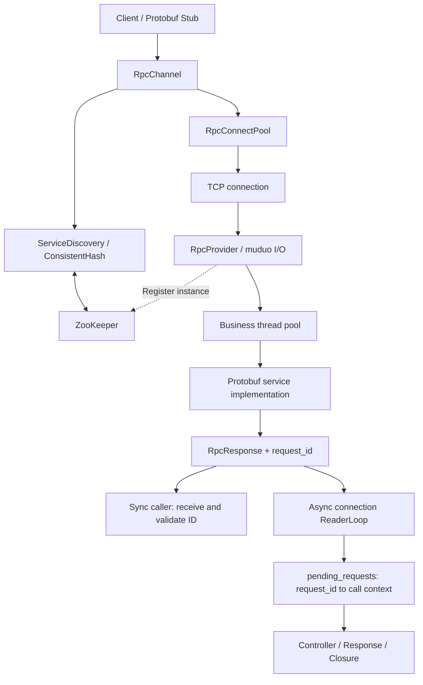

# RPC · C++17 RPC Framework

[简体中文](README.md) | **English**

A Linux-oriented C++17 RPC framework prototype featuring Protobuf service calls, TCP connection reuse, ZooKeeper discovery, consistent-hash routing, and request-ID-based asynchronous response dispatch.


[Features](#features) · [Architecture](#architecture) · [Getting started](#getting-started) · [Validation and performance](#validation-and-performance) · [Current limitations](#current-limitations)

## Overview

The client invokes a Protobuf Stub, service discovery resolves instances, consistent hashing selects a target, and a connection pool supplies a TCP connection. The server decodes the request, dispatches work to a business thread pool, and returns a unified response carrying the request ID.

**Project status:** This version is intended for development validation and single-host/two-instance experiments. It supports synchronous calls, asynchronous callbacks, multiple outstanding requests on a connection, and protocol error handling, but is not production-ready. See [Current limitations](#current-limitations).

## Features

| Capability | Implementation |
| --- | --- |
| Service calls | Protobuf generic services / Stubs with reflective service and method lookup |
| Networking and dispatch | muduo Reactor networking; currently 4 I/O threads and 100 business threads |
| Sync and async APIs | `done==nullptr` waits synchronously; a supplied `Closure` selects asynchronous response dispatch |
| Request correlation | Atomically incremented `uint64` IDs echoed in responses; async pending calls dispatched by ID |
| Discovery | ZooKeeper ephemeral instance nodes, child watches, and local routing caches |
| Routing | Consistent hashing with virtual nodes; request ID strings currently serve as routing keys |
| Connection management | TCP reuse by endpoint and connection warm-up; idle connections use an MPMC queue, while bucket management uses mutexes |
| Framing | Length-prefixed messages with partial/coalesced frame handling; request errors allow subsequent buffered frames to be processed |
| Failure reporting | Unified response envelopes, preserved request IDs, bad-connection cleanup, and failure callbacks for affected async calls |
| Alternate nodes | The synchronous path can try one alternate instance for eligible connection failures before sending; sent requests are never replayed |
| Tooling | CMake static library and example binaries; Docker Compose configuration for local demonstrations |

## Architecture



The synchronous path borrows a pooled connection, sends a request, waits for its response, and returns the connection. Within each Channel, the asynchronous path retains connections by endpoint and starts one reader thread per connection. A write mutex prevents interleaved request frames; the reader finds pending calls by `request_id` and invokes their callbacks.

The asynchronous API does not wait for the business response, but discovery, connection establishment, and sending can still block. Normal response callbacks run on the connection reader thread; validation or send failures can also invoke callbacks on the calling thread.

## Protocol and errors

```text
Request:  total_len [4B] | header_len [4B] | RpcHeader | business args
Response: response_len [4B] | RpcResponse
```

Length prefixes use network byte order. `total_len` includes the `header_len` field, header, and arguments, excluding its own four bytes. `response_len` is the serialized response envelope size.

| Protobuf message | Fields |
| --- | --- |
| `RpcHeader` | `service_name=1`, `method_name=2`, `args_size=3`, `request_id=4` |
| `RpcResponse` | `error_code=1`, `error_message=2`, `payload=3`, `request_id=4` |

The server caps request `total_len` and response envelope size at **4 MiB**. An oversized response is replaced with an error envelope preserving the original request ID; its business payload is omitted.

| Framework code | Meaning |
| ---: | --- |
| `0` | Framework call succeeded; inspect the payload for business results |
| `1` | `SERVICE_NOT_EXIST` |
| `2` | `METHOD_NOT_EXIST` |
| `3` | `INVALID_REQUEST` |
| `4` | `RESPONSE_SERIALIZATION_FAILED` |
| `5` | `RESPONSE_TOO_LARGE` |

Unknown services, unknown methods, and invalid business arguments affect only the current request: the server replies with an error and continues draining frames. Protocol errors such as invalid frame lengths or headers close the connection. Local discovery, connection, and I/O failures are reported through `RpcController::Failed()` / `ErrorText()` and do not necessarily map to the remote codes above.

## Getting started

### Environment and dependencies

Linux is the runtime target; Ubuntu 24.04 is recommended. Dependencies include a C++17 compiler, CMake, the Protobuf compiler and development library, Boost, glog, the ZooKeeper multithreaded C client library, and installed muduo headers and libraries.

Install Ubuntu dependencies:

```bash
sudo apt-get update
sudo apt-get install -y build-essential cmake libboost-dev libprotobuf-dev protobuf-compiler libgoogle-glog-dev libzookeeper-mt-dev
```

The repository includes `third_party/muduo`, but the top-level CMake build does not build or install it automatically. If muduo is not installed, the following follows the installation layout used by the Dockerfile:

```bash
cmake -S third_party/muduo -B build/muduo -DMUDUO_BUILD_EXAMPLES=OFF -DCMAKE_BUILD_TYPE=Release
cmake --build build/muduo -j"$(nproc)"
sudo cp -a third_party/muduo/muduo /usr/local/include/
sudo cp build/muduo/lib/libmuduo_base.a build/muduo/lib/libmuduo_net.a /usr/local/lib/
sudo ldconfig
```

Start a ZooKeeper server separately. Installing the C client development package does not start a ZooKeeper service.

### Build and run

From the repository root:

```bash
cmake -S . -B build -DCMAKE_BUILD_TYPE=Release
cmake --build build -j"$(nproc)"
```

CMake currently sets Release flags explicitly to `-O2`, without the default `-DNDEBUG`. Use a separate directory for debugging: `cmake -S . -B build-debug -DCMAKE_BUILD_TYPE=Debug`, to keep build artifacts separate.

Check `test.conf`, ensure the server address is reachable by clients, and wait for ZooKeeper to become ready:

```ini
rpcserverip=127.0.0.1
rpcserverport=8000
zookeeperip=127.0.0.1
zookeeperport=2181
```

`rpcserverip` is used for server listening/registration and example client connection warm-up. For multiple machines, use the server's client-reachable IPv4 address.

Start the server:

```bash
./build/server -i ./test.conf
```

In another terminal, start the client:

```bash
./build/client -i ./test.conf
```

The client runs a single async call, a batch of 100 async requests, and a synchronous benchmark with 100 threads making 1,000 calls each. The example service simulates approximately 5ms of business work.

### Generate protocol code

Generated C++ files are checked into the repository. After changing a schema, regenerate them with a `protoc` version compatible with your local Protobuf development library:

```bash
protoc -I src --cpp_out=src src/rpc_header.proto
protoc -I example --cpp_out=example example/user.proto
```

The example service schema requires `option cc_generic_services=true`. CMake does not currently generate protocol code automatically.

### Docker Compose

```bash
docker compose build
docker compose up -d zookeeper
# Wait for ZooKeeper readiness before starting the server.
docker compose up -d rpc-server
docker compose logs rpc-server
# Run the client after confirming service registration and listening.
docker compose run --rm rpc-client
docker compose down
```

Compose uses `test.docker.conf` and the fixed subnet `172.30.0.0/24`. If it conflicts with your network, update both Compose addresses and the configuration file. `depends_on` specifies startup order; readiness health checks are not configured. This is a local demonstration workflow; containers were not revalidated during this documentation update.

## Validation and performance

### Automated and integration tests

The following targets are built by CMake. No CTest suite is currently registered, so run each executable directly:

```bash
cmake --build build --target controller_test config_test hash_alternative_test pool_borrow_test cluster_test_server cluster_test_client -j"$(nproc)"
./build/controller_test
./build/hash_alternative_test
./build/pool_borrow_test
./build/config_test -i ./test.conf
```

| Target | Scope |
| --- | --- |
| `controller_test` | Controller state and reset behavior |
| `hash_alternative_test` | Consistent-hash alternate-node selection boundaries |
| `pool_borrow_test` | Connection-pool state recovery after borrow failures |
| `cluster_test_server` / `cluster_test_client` | Two-instance request distribution and routing during node removal/recovery |
| `config_test` | Configuration file loading |

The two-node test requires ZooKeeper and two separate service instances, and exercises the synchronous call path. Setup, operator steps, and pass criteria are documented in the [two-node integration test guide](test/cluster/README.md). These integration tests are not reported as CI automation results.

The following are manually observed development regressions, not automated CI reports:

| Scenario | Observed result |
| --- | --- |
| Async batch, 2026-10-14 | 100 completed, 0 failed, `finished=1` |
| Sync benchmark, 2026-10-14 | 100,000 calls, 100,000 successes, 0 failures |
| Consecutive mixed requests | Unknown service, unknown method, invalid arguments, and a valid request sent on one connection; all four responses carried the correct IDs |
| Oversized response injection | Temporarily reducing the size limit produced `RESPONSE_TOO_LARGE`; normal calls passed after restoring the limit |
| Server disconnect | Client read failure and discovery node changes were observed while checking connection failure handling |

One manually observed synchronous benchmark: **100,000 calls in 6.6123 seconds, approximately 15,123 QPS**. Conditions: Ubuntu VMware VM, one service instance, 100 client threads, connection warm-up, and approximately 5ms simulated business work. It used a Debug build; complete hardware and system-load metadata were not recorded. Treat this as a development observation, not a reproducible performance guarantee.

Subsequent observations on 2026-10-18 in the same environment: single-instance Release (actual `-O2`) averaged approximately **16,619 QPS** across five runs. One two-instance example-client run reached **17,307.5 QPS**, with 100,000 successes and zero failures. The latter measures aggregate client throughput, not per-node capacity or linear scaling, and does not replace the dedicated distribution and fault tests.

This is a synchronous benchmark, not an async throughput measurement or a cross-environment performance guarantee. The change from roughly 6.7K to 15K QPS has not been attributed through controlled comparisons. A single batched socket write also does not guarantee a single server read; the mixed-request regression still needs a deterministic buffer-level test.

## Repository layout

```text
.
├── src/
│   ├── include/              # Channel, Provider, controller, and pool interfaces
│   ├── rpc_channel.cc        # Sync/async calls, response matching, connection reads
│   ├── rpc_provider.cc       # Registration, framing, dispatch, response sending
│   ├── service_discovery.cc  # ZooKeeper discovery and routing caches
│   ├── consistent_hash.cc    # Consistent hashing
│   ├── rpc_connect_pool.cc   # Connection borrowing, return, and warm-up
│   └── rpc_header.proto      # Framework headers and response envelopes
├── example/                  # Login service, client, and configuration check
├── test/                     # Focused checks and integration tests
│   └── cluster/              # Two-node distribution and failover experiments
├── third_party/muduo/        # muduo source
├── CMakeLists.txt
├── Dockerfile
├── docker-compose.yml
├── test.conf
├── test.docker.conf
├── README.md
└── README.en.md
```

## Current limitations

- **Call control:** Framework-level deadlines, cancellation, automatic retries of sent requests, and idempotency guarantees are not implemented. Only the synchronous path can try one alternate node for eligible connection failures before sending; the async path does not perform this reselection. Example wait timeouts do not cancel outstanding RPCs.
- **Concurrency and lifetime:** Each async connection has a reader thread. Keep callbacks short and non-throwing to avoid blocking reads. Responses and controllers must remain alive until callbacks finish. Destroying a Channel from its own callback, or destroying it concurrently with new calls, is unsupported.
- **Resource reclamation:** Disconnected connection states are retained until Channel destruction and thread joining. Long-running resource growth under frequent reconnects needs improvement, as do connection-generation isolation and failure-race validation.
- **Operations and security:** The current connection path uses IPv4. TLS, authentication, rate limiting, backpressure, health checks, and complete session-expiration recovery remain incomplete.
- **Engineering validation:** Deterministic protocol regressions, Sanitizers, CI, reproducible Release benchmarks, and latency percentiles remain to be added.

## Contributing and licensing

Use a dedicated branch and submit a Pull Request describing the problem, behavioral changes, and normal/failure-path validation. Protocol changes should include schemas, generated files, and both language versions of the documentation.

No project-level `LICENSE` file currently exists at the repository root; the project has not declared its own open-source license. Third-party components retain their respective licenses.
