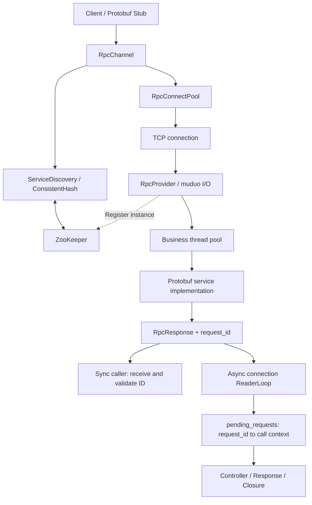

# RPC · C++17 RPC Framework

**简体中文** | [English](README.en.md)

基于 C++17 的 RPC 框架，实现 Protobuf 服务调用、TCP 长连接复用、ZooKeeper 服务发现，以及基于请求 ID 的异步响应分发。


[核心能力](#核心能力) · [系统架构](#系统架构) · [快速开始](#快速开始) · [验证与性能](#验证与性能) · [当前边界](#当前边界)

## 项目概览

本项目围绕完整 RPC 调用链构建：客户端通过 Protobuf Stub 发起调用，服务发现获取实例并通过一致性哈希选择目标，连接池提供 TCP 连接，服务端解析协议后将任务提交至业务线程池，最终返回携带请求 ID 的统一响应。

项目用于系统编程与分布式通信的工程实践，目前支持同步调用、异步回调、同连接多请求在途，以及多种协议和请求错误处理。生产使用前仍需完善超时、取消、安全和运行治理能力，具体见[当前边界](#当前边界)。

## 核心能力

| 能力 | 实现方式 |
| --- | --- |
| 服务调用 | Protobuf generic service / Stub，基于反射查找服务和方法 |
| 网络与分发 | muduo Reactor 网络层；当前配置为 4 个 I/O 线程、100 个业务线程 |
| 同步与异步 | `done==nullptr` 同步等待；传入 `Closure` 走异步响应分发 |
| 请求关联 | 原子递增 `uint64` 请求 ID，响应原样回传 ID；异步在途表按 ID 分发 |
| 服务发现 | ZooKeeper 临时实例节点、子节点监听和本地路由缓存 |
| 路由 | 带虚拟节点的一致性哈希，当前使用请求 ID 字符串作为路由键 |
| 连接管理 | 按端点复用 TCP 连接，支持预热；空闲连接使用 MPMC 队列，桶管理仍使用互斥锁 |
| 帧处理 | 长度前缀协议，处理粘包和半包；单请求错误回复后继续处理后续缓冲帧 |
| 异常反馈 | 统一响应信封、请求 ID 保留、坏连接清理及受影响异步请求失败回调 |
| 工具链 | CMake 静态库及示例程序，提供本地 Docker Compose 演示配置 |

## 系统架构



同步路径从池中借用连接，发送请求并等待对应响应后归还连接。异步路径在每个 Channel 内按端点持有连接，每条连接使用独立读取线程；发送端通过写锁避免请求帧交叉，读取端按 `request_id` 查找在途请求并完成回调。

异步 API 不等待业务响应，但服务发现、建连和发送仍可能阻塞。正常响应回调在连接读取线程执行；调用前置检查或发送失败时，回调也可能在调用线程执行。

## 协议与错误模型

```text
Request:  total_len [4B] | header_len [4B] | RpcHeader | business args
Response: response_len [4B] | RpcResponse
```

长度前缀采用网络字节序。`total_len` 包含 `header_len` 字段、请求头与参数，不包含自身的 4 字节；`response_len` 为序列化响应信封的字节数。

| Protobuf 消息 | 字段 |
| --- | --- |
| `RpcHeader` | `service_name=1`、`method_name=2`、`args_size=3`、`request_id=4` |
| `RpcResponse` | `error_code=1`、`error_message=2`、`payload=3`、`request_id=4` |

服务端请求 `total_len` 上限及响应信封上限均为 **4 MiB**。超大响应被替换为保留原请求 ID 的错误信封，业务 payload 不返回。

| 框架错误码 | 含义 |
| ---: | --- |
| `0` | 框架调用成功；业务结果仍需检查 payload |
| `1` | `SERVICE_NOT_EXIST` |
| `2` | `METHOD_NOT_EXIST` |
| `3` | `INVALID_REQUEST` |
| `4` | `RESPONSE_SERIALIZATION_FAILED` |
| `5` | `RESPONSE_TOO_LARGE` |

未知服务、未知方法或参数解析失败只影响当前请求：服务端发送错误响应后继续拆包。非法帧长度、非法请求头等协议错误触发连接关闭。客户端本地发现、连接和收发错误通过 `RpcController::Failed()` / `ErrorText()` 反馈，不一定对应上表的远端错误码。

## 快速开始

### 环境与依赖

运行目标为 Linux，建议 Ubuntu 24.04。需要 C++17 编译器、CMake、Protobuf 编译器及开发库、Boost、glog、ZooKeeper C 多线程客户端库，以及已安装的 muduo 头文件和库。

Ubuntu 依赖安装：

```bash
sudo apt-get update
sudo apt-get install -y build-essential cmake libboost-dev libprotobuf-dev protobuf-compiler libgoogle-glog-dev libzookeeper-mt-dev
```

仓库包含 `third_party/muduo`，但顶层 CMake 不会自动构建或安装它。尚未安装 muduo 时，可参照 Dockerfile 的安装布局执行：

```bash
cmake -S third_party/muduo -B build/muduo -DMUDUO_BUILD_EXAMPLES=OFF -DCMAKE_BUILD_TYPE=Release
cmake --build build/muduo -j"$(nproc)"
sudo cp -a third_party/muduo/muduo /usr/local/include/
sudo cp build/muduo/lib/libmuduo_base.a build/muduo/lib/libmuduo_net.a /usr/local/lib/
sudo ldconfig
```

ZooKeeper 服务端需另行启动；安装 C 客户端开发库不会启动 ZooKeeper 服务。

### 构建与运行

在仓库根目录执行：

```bash
cmake -S . -B build -DCMAKE_BUILD_TYPE=Debug
cmake --build build -j"$(nproc)"
```

检查 `test.conf`，确认服务地址可被客户端访问，ZooKeeper 已就绪：

```ini
rpcserverip=127.0.0.1
rpcserverport=8000
zookeeperip=127.0.0.1
zookeeperport=2181
```

`rpcserverip` 同时用于服务监听/注册，以及示例客户端连接预热。跨机器运行时应设置为客户端可达的服务端 IPv4 地址。

先启动服务端：

```bash
./build/server -i ./test.conf
```

另一个终端启动客户端：

```bash
./build/client -i ./test.conf
```

客户端依次执行单次异步调用、100 条异步请求批次，以及 100 个线程各 1,000 次同步调用的压测。示例服务执行约 5ms 的模拟业务等待。

### 协议代码生成

仓库已包含生成的 C++ 文件。修改协议后使用与本地 Protobuf 开发库兼容的 `protoc` 重新生成：

```bash
protoc -I src --cpp_out=src src/rpc_header.proto
protoc -I example --cpp_out=example example/user.proto
```

示例服务协议依赖 `option cc_generic_services=true`。当前 CMake 不自动执行协议代码生成。

### Docker Compose

```bash
docker compose build
docker compose up -d zookeeper
# 等待 ZooKeeper 就绪，再启动服务端。
docker compose up -d rpc-server
docker compose logs rpc-server
# 确认服务已注册并监听后运行客户端。
docker compose run --rm rpc-client
docker compose down
```

Compose 使用 `test.docker.conf` 和固定子网 `172.30.0.0/24`。如与本机网络冲突，需要同步调整 Compose 地址和配置文件。`depends_on` 仅声明启动顺序，当前未配置就绪健康检查；本节为本地演示流程，本轮未重新执行容器验证。

## 验证与性能

仓库内可直接运行的检查：

```bash
./build/controller_test
./build/config_test -i ./test.conf
```

`controller_test` 验证控制器状态与重置；`config_test` 输出配置读取结果。当前未注册 CTest 测试集。

以下为开发过程中手动执行的回归结果，并非 CI 自动测试报告：

| 场景 | 观察结果 |
| --- | --- |
| 2026-10-14 异步批次 | 100 条完成、0 条失败，`finished=1` |
| 2026-10-14 同步压测 | 100,000 次调用，100,000 次成功、0 次失败 |
| 混合请求连续发送 | 同连接发送未知服务、未知方法、非法参数和正常请求，四条响应均带回正确 ID |
| 超大响应故障注入 | 临时降低大小上限，观察到 `RESPONSE_TOO_LARGE`；恢复上限后正常调用通过 |
| 服务端断连 | 观察到客户端读取失败及服务发现节点变更，用于检查连接异常处理 |

最新同步实测：**6.6123 秒 / 100,000 次，约 15,123 QPS**。条件为 Ubuntu VMware 虚拟机、单服务实例、100 个客户端线程、连接预热及约 5ms 模拟业务等待；沿用此前 Debug 构建流程，未单独保存完整硬件、负载与构建元数据。

QPS 来自同步压测，不代表异步吞吐量，也不构成跨环境性能保证。此前约 6.7K QPS 与当前约 15K QPS 的差异尚未通过受控对照定位原因。单次批量 socket 写入也不保证服务端一次读取全部请求，混合请求验证仍需补充确定性缓冲区测试。

## 目录结构

```text
.
├── src/
│   ├── include/              # Channel、Provider、控制器、连接池等接口
│   ├── rpc_channel.cc        # 同步/异步调用、响应匹配与连接读取
│   ├── rpc_provider.cc       # 服务注册、拆包、业务分发与响应发送
│   ├── service_discovery.cc  # ZooKeeper 发现与路由缓存
│   ├── consistent_hash.cc    # 一致性哈希
│   ├── rpc_connect_pool.cc   # 连接借用、归还与预热
│   └── rpc_header.proto      # 框架请求头与响应信封
├── example/                  # 登录服务、客户端与配置检查
├── test/                     # 控制器测试
├── third_party/muduo/        # muduo 源码
├── CMakeLists.txt
├── Dockerfile
├── docker-compose.yml
├── test.conf
├── test.docker.conf
├── README.md
└── README.en.md
```

## 当前边界

- **调用控制**：尚未实现框架级请求 deadline、取消、自动重试或幂等保障；示例中的等待超时不等于取消在途 RPC。
- **并发与生命周期**：每条异步连接使用一个读取线程；回调应简短且不抛出异常，避免阻塞读取。响应对象和控制器必须存活至回调完成；不支持回调中销毁自身 Channel，或析构与新调用并发进行。
- **资源回收**：断连状态保留到 Channel 析构并 `join`；频繁重连的长期资源增长仍需完善。连接代际隔离和故障竞争路径需要进一步验证。
- **服务治理与安全**：当前连接路径使用 IPv4；TLS、鉴权、限流、背压、健康检查和完整的会话过期恢复尚未完善。
- **工程验证**：待补充确定性协议回归、Sanitizer、CI、可复现 Release 基准及延迟分位数。

## 贡献与许可

建议通过独立分支提交 Pull Request，说明问题、行为变化、正常及失败路径验证。涉及协议修改时，应同时更新 `.proto`、生成文件和中英文说明。

仓库当前没有项目根级 `LICENSE` 文件，尚未声明项目自身的开源许可。第三方组件遵循各自许可。
